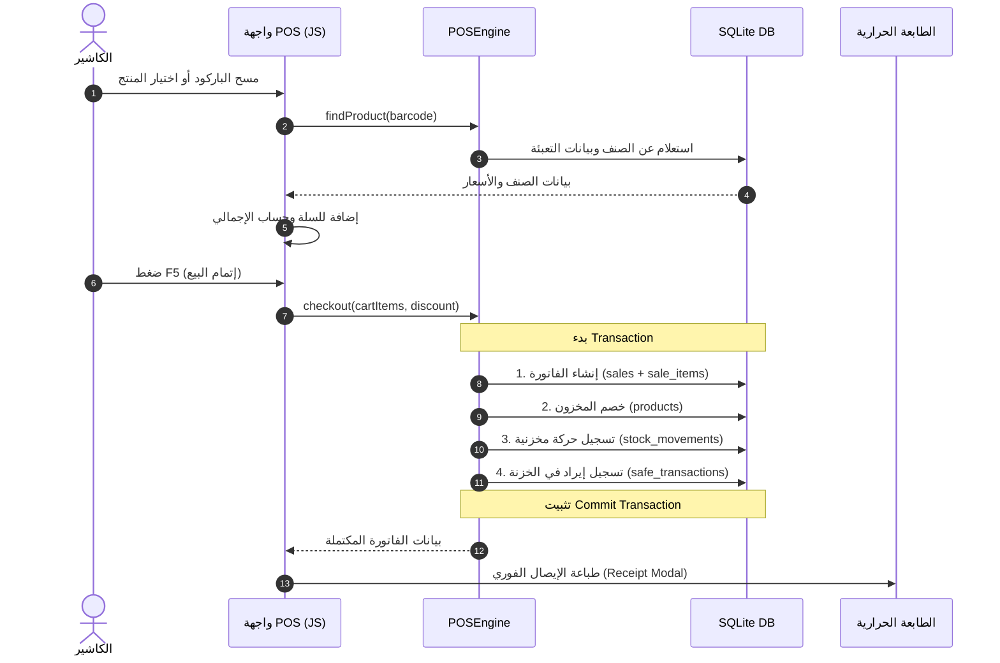

# 🛒 نظام عطارة الحكمة — لنقاط البيع وإدارة المخزون (POS & Inventory System)

نظام متكامل ومستقل لإدارة نقاط البيع (POS)، المخزون، المشتريات، المبيعات، الخزنة النقدية، وحسابات الموظفين، مصمم ليعمل كـ Desktop Application دون الحاجة لاتصال بالإنترنت (Offline-First).

---

## 📑 جدول المحتويات
1. [الميزات الرئيسية](#-الميزات-الرئيسية)
2. [التقنيات المستخدمة والمعمارية](#-التقنيات-المستخدمة-والمعمارية)
3. [هيكل المشروع والملفات](#-هيكل-المشروع-والملفات)
4. [دليل التثبيت والتشغيل](#-دليل-التثبيت-والتشغيل)
5. [اختصارات لوحة المفاتيح للكاشير](#-اختصارات-لوحة-المفاتيح-للكاشير)
6. [دورة حياة البيانات (System Flow)](#-دورة-حياة-البيانات-system-flow)
7. [التحليل التقني والمشاكل المكتشفة](#-التحليل-التقني-والمشاكل-المكتشفة)
8. [خريطة التطوير والتوسعات المستقبلية (Roadmap)](#-خريطة-التطوير-والتوسعات-المستقبلية-roadmap)

---

## ✨ الميزات الرئيسية

### 1. 🛒 نقطة البيع السريعة (POS Core)
- **دعم الباركود والماسح الضوئي:** استجابة سريعة لقارئ الباركود مع معالجة ذكية للـ Buffer لمنع أخطاء الإدخال السريع.
- **تعدد طرق البيع والوحدات:**
  - بيع بالقطعة / الوحدة الفردية (Unit).
  - بيع بالكرتونة / العبوة / الشوال / الدستة (Pack Mode) مع الحساب التلقائي للكميات المحولة.
  - بيع بالوزن (Weight Mode) للأصناف الموزونة بالكيلو والجرام.
  - **حاسبة تحويل السعر لوزن:** إمكانية كتابة مبلغ نقدي (مثلاً: 10 ج.م) ليقوم النظام بحساب الوزن المكافئ تلقائياً.
- **خصومات وسعر يدوي:** إمكانية تطبيق خصم على الفاتورة أو إدراج منتجات بسعر يدوي مباشر.
- **طباعة الإيصال الحراري:** دعم الطباعة المباشرة للإيصالات الحرارية (80mm / 58mm) مع دعم وضع `kiosk-printing`.

### 2. 📦 إدارة المنتجات والمخزون
- **تعدد الباركودات:** دعم حتى 3 باركودات مختلفة لكل منتج + كود PLU سريع.
- **التحقق اللحظي من التكرار:** تنبيه فوري عند تكرار الباركود أو كود PLU أثناء الإدخال.
- **تتبع حركة المخزون:** تسجيل كامل لكل حركة (شراء، بيع، تسوية، مرتجع، تعديل يدوي) في سجل الحركات `stock_movements`.
- **تنبيهات النواقص:** رصد المنتجات التي وصلت لحد الطلب الأدنى (Low Stock Alert) وتقييم القيمة الإجمالية لرأس مال البضاعة.

### 3. 🧾 إدارة المشتريات والموردين
- **فواتير الشراء المتقدمة:**
  - استيراد تلقائي لأصناف آخر فاتورة لنفس المورد بنقرة واحدة.
  - دعم بضائع البونص / الهدية (بدون تكلفة في الإجمالي).
  - دعم المرتجع المباشر للمورد داخل فاتورة الشراء.
  - تحديث أسعار التكلفة تلقائياً عند حفظ الفاتورة.
- **ملف المورد وسجل الحسابات:** تتبع إجمالي المشتريات وعدد الفواتير لكل مورد.

### 4. 💵 المبيعات والمرتجعات والإلغاء
- **إلغاء الفواتير (Void):** إمكانية إلغاء الفاتورة بالكامل مع إعادة البضاعة للمخزن وعكس القيد المالي في الخزنة آلياً.
- **مرتجعات المبيعات (Sales Return):** إنشاء فاتورة مرتجع للأصناف المسترجعة مع ضبط المخزون وسحب القيمة من الخزنة.
- **تعديل الفواتير:** إمكانية تعديل الكميات والأسعار مع إعادة احتساب المخزون والخزنة تلقائياً.

### 5. 💰 الخزنة النقدية والمرتبات (Safe & Financials)
- **حركات الخزنة:** تسجيل الإيرادات، المصروفات التشغيلية، المسحوبات الشخصية، السلف، وسداد الرواتب.
- **الاستحقاق الشهري التلقائي للرواتب:** تشغيل آلي شهري (`runMonthlyAccrual`) لاحتساب رواتب الموظفين وحساب كشف الحساب التراكمي:
  $$\text{الرصيد المستحق} = \text{إجمالي الاستحقاقات} - \text{الرواتب المسددة} - \text{السلف}$$

### 6. 📈 التقارير ولوحة التحكم
- تقرير المبيعات اليومي والإجمالي لفترة زمنية محددة.
- تقرير المنتجات الأكثر مبيعاً والأقل مبيعاً.
- تقرير مشتريات الموردين وحركات المخزون.
- **تقرير مالي تفصيلي للأرباح والخسائر:** مقارنة الإيرادات الحقيقية بالمصروفات التشغيلية والمشتريات وتحديد صافي الربح.

---

## 🛠️ التقنيات المستخدمة والمعمارية

```
[ Frontend: HTML5 / CSS3 / Vanilla JS (ES5/ES6) ]
                         │  (Fetch API / JSON / XHR)
                         ▼
[ Routing & Entry: www/index.php ]
                         │
        ┌────────────────┼────────────────┐
        ▼                ▼                ▼
  [Controllers]     [Services]       [Engines]
  (POS, Sales,    (Purchase, Sale,  (POSEngine,
   Products...)    Employee, Safe)  ReportEngine)
        │                │                │
        └────────────────┼────────────────┘
                         ▼
               [Repositories (DAL)]
                         │  (PDO Prepared Statements)
                         ▼
          [SQLite 3: pos_system.db (WAL Mode)]
```

- **الغلاف المكتبي (Desktop Wrapper):** [PHP Desktop Chrome](https://github.com/cztomczak/phpdesktop) (CEF Chromium 57).
- **لغة الواجهة الخلفية (Backend):** PHP 7.1.3 (مع بنية Object-Oriented و MVC خفيف).
- **قاعدة البيانات:** SQLite 3 مع تفعيل وضع `PRAGMA journal_mode = WAL` و `busy_timeout = 5000` و `foreign_keys = ON` للسرعة وحماية البيانات.
- **الواجهة الأمامية (Frontend):** Vanilla JavaScript (بدون مكاتب خارجية ثقيلة لضمان أعلى سرعة استجابة) + CSS3 بتصميم متجاوب يدعم اللغة العربية RTL.

---

## 📂 هيكل المشروع والملفات

```plaintext
cashier_system/
├── Alhakma.exe                # الملف التنفيذي للبرنامج على ويندوز
├── settings.json              # إعدادات PHPDesktop وحجم الشاشة وتكوين Chromium
├── php/                       # بيئة تشغيل PHP 7.1 المدمجة
├── www/                       # مجلد تطبيق الويب الرئيسي
│   ├── index.php              # الموجه الرئيسي (Router) ومدخل التطبيق
│   ├── data/
│   │   └── pos_system.db      # ملف قاعدة بيانات SQLite
│   ├── app/
│   │   ├── config/            # إعدادات قاعدة البيانات وإدارة المايجريشن
│   │   │   └── database.php
│   │   ├── controllers/       # وحدات التحكم (POS, Sale, Product, Safe, Employee...)
│   │   ├── database/
│   │   │   └── migrations/    # ملفات SQL لتهيئة وتحديث جداول قاعدة البيانات
│   │   ├── helpers/           # مساعدات الاستجابة والتحقق (Response.php, Validator.php)
│   │   ├── pos_engine/        # محرك العمليات الأساسي لنقطة البيع (POSEngine.php)
│   │   ├── inventory_engine/  # محرك إدارة المخزون
│   │   ├── report_engine/     # محرك التقارير
│   │   ├── repositories/      # طبقة التعامل مع البيانات (Data Access Layer)
│   │   ├── services/          # منطق الأعمال والحسابات (Business Logic Layer)
│   │   └── views/             # صفحات وواجهات النظام (POS, Sales, Products, Reports...)
│   └── public/
│       ├── css/               # ملفات التنسيق والمظهر
│       ├── js/                # سكربتات الكاشير ومعالجة الباركود (pos_core_v2.js)
│       └── images/            # الشعارات والأيقونات
```

---

## 🚀 دليل التثبيت والتشغيل

### التشغيل المباشر كبرنامج سطح مكتب:
1. تأكد من فك ضغط المجلد بالكامل في أي مسار على جهاز Windows.
2. قم بتشغيل الملف: `Alhakma.exe`.
3. سيبدأ النظام تلقائياً ويفتح واجهة لوحة التحكم والكاشير.

### التشغيل على خادم ويب محلي (XAMPP / Laragon / PHP Built-in Server):
```bash
cd www
php -S localhost:8000
```
ثم افتح المتصفح على الرابط: `http://localhost:8000`

---

## ⌨️ اختصارات لوحة المفاتيح للكاشير

| المفتاح | الوظيفة |
|---|---|
| **`F2`** | التركيز المباشر على حقل مسح الباركود |
| **`F3`** | فتح تفاصيل الصنف المحدد في السلة |
| **`F5`** | إتمام البيع والمحاسبة الفورية (Checkout) |
| **`F8`** | التبديل السريع لنوع الوحدة (قطعة ↔ عبوة/طرد) |
| **`↑ / ↓`** | التنقل بين أصناف السلة |
| **`Esc`** | إغلاق أي نافذة منبثقة مفتوحة والعودة لحقل الباركود |

---

## 🔄 دورة حياة البيانات (System Flow)



---

## ⚠️ التحليل التقني والمشاكل المكتشفة

خلال التدقيق البرمجي للكود تم رصد الملاحظات التقنية التالية للإصلاح:

1. **تشغيل المايجريشن المتكرر:** استدعاء `$db->migrate()` في كل ريكويست بملف `index.php` يسبب بطء وكتابة أخطاء في `error.log`.
2. **تفريغ السلة بعد البيع:** السطور المسؤولة عن تصفير السلة بعد البيع في `pos_core_v2.js` معطلة وتتطلب التفعيل.
3. **ازدواجية حساب المشتريات بالتقرير المالي:** كويري التقرير اليومي بـ `ReportService.php` يجمع المشتريات من جدولين مما يضاعف قيمتها في التقارير.
4. **حقل سعر الشراء الفردي:** حقل `purchase_price` في شاشة إضافة المنتج مضبوط على `readonly` مما يمنع إضافة سعر لمنتج يباع بالقطعة فقط.
5. **تحديث سعر البيع من الشراء:** إدخال سعر بيع جديد في فاتورة المشتريات لا يتم ترحيله لجدول المنتجات في الـ Backend.
6. **جداول الخزنة والموظفين:** جدولي `employees` و `safe_transactions` غير مدرجين داخل مجلد `database/migrations/`.
7. **تحديث المجموع الفرعي:** تعديل الفاتورة لا يحدث قيمة `subtotal` في جدول `sales`.
8. **المرتجع للوزن:** حقول المرتجعات محددة بـ `step="1"` مما يقيد إرجاع الكميات الكسرية (كالجرامات).

---

## 🗺️ خريطة التطوير والتوسعات المستقبلية (Roadmap)

لجعل النظام متوافقاً كـ **Universal POS** يناسب جميع الأنشطة التجارية في السوق:

- [ ] **إدارة الورديات (Shifts Management):** فتح وإغلاق الوردية، حساب عهدة الكاشير، وتقارير X و Z للعجز والزيادة.
- [ ] **تعدد الصلاحيات والمستخدمين:** توزيع أدوار (كاشير، مشرف، مدير).
- [ ] **تعدد طرق الدفع:** دفع مقسم (كاش + فيزا + محافظ إلكترونية) وإدارة حسابات العملاء والبيع الآجل (الشكك).
- [ ] **الربط المباشر مع الهاردوير:**
  - قراءة باركود موازين الباركود المشفرة (20xxxx / 21xxxx) أو عبر Serial Port.
  - طباعة حرارية صامتة ومباشرة عبر بروتوكول `ESC/POS` مع إشارة فتح درج النقدية.
  - شاشة عرض للعميل (Pole Display).
- [ ] **المخزون المتقدم:** دعم تواريخ الصلاحية، أرقام التشغيلات (Batches)، وتعدد المخازن والفروع.
- [ ] **الفاتورة الإلكترونية:** دعم متطلبات الفاتورة الإلكترونية ورمز الاستجابة السريع المشفر (QR Code).
- [ ] **النسخ الاحتياطي السحابي:** جدولة نسخ احتياطي لقاعدة البيانات تلقائياً.

---

**تم إعداد هذا التوثيق ليكون مرجعاً تقنياً وتشغيلياً شاملاً لتطوير وصيانة النظام.**
